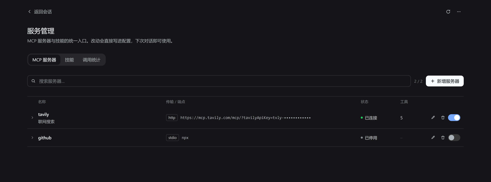
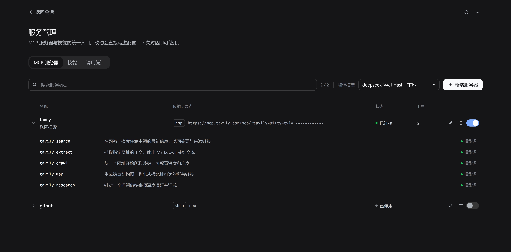
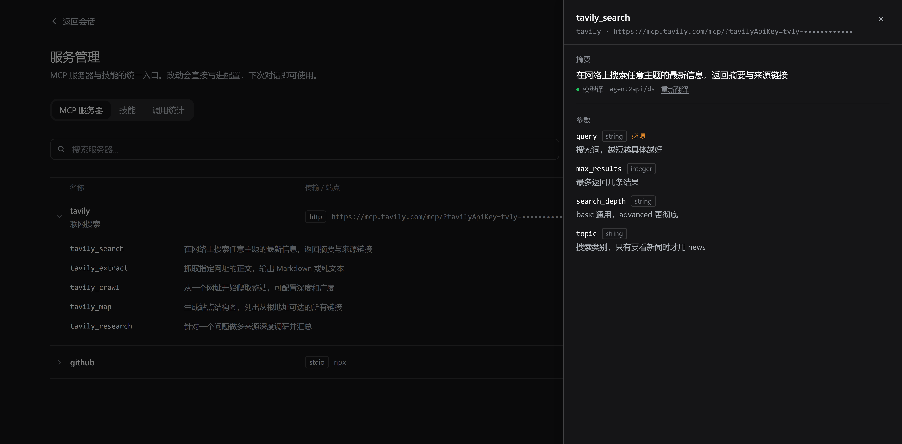
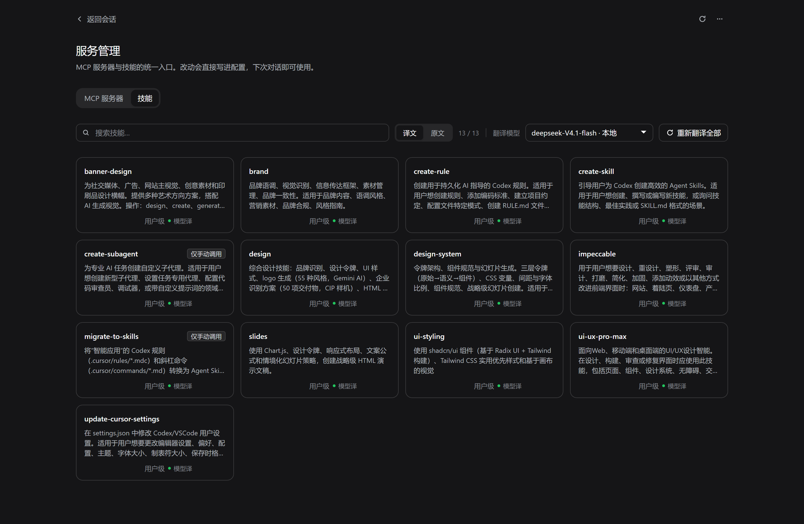

<div align="center">

# DSH Service Manager

**One page for every MCP server and skill in DeepSeek Harness.**

Add, edit, enable, disable and delete MCP servers without touching YAML · browse your skills · translate their English summaries with your own model.

[](LICENSE)
[](#compatibility)
[](#development)
[](package.json)

English · [简体中文](README.zh-CN.md)

</div>

## Why

DeepSeek Harness ships no MCP management UI. Adding a server means hand-writing YAML; finding out whether it connected means going back to a session and trying. Skills live as files on disk with English summaries you read once and forget.

This plugin adds the missing page. It **never edits your DSH configuration files** — it loads its own file through the official `cordis:include` mechanism, so `cordis.patch.yml` stays exactly as you wrote it.

## Contents

- [Features](#features) · [Screenshots](#screenshots) · [Requirements](#requirements) · [Install](#install)
- [Usage](#usage) · [What it writes](#what-it-writes) · [Security boundaries](#security-boundaries)
- [How it works](#how-it-works) · [Compatibility](#compatibility) · [FAQ](#faq)
- [Development](#development) · [Changelog](#changelog) · [Contributing](#contributing) · [License](#license)

## Features

### MCP servers

- **Full CRUD without YAML** — add, edit, delete, and toggle servers from a table
- **Expand to the tool list** — every tool a server registers, one line each, with the full description on hover
- **Tool drawer** — summary on top, parameter table below; parameter descriptions are translated, parameter names stay English because they are the identifiers you actually type
- **Reconnect is visible** — saving triggers a background include refresh; the page polls the reconnect state instead of leaving you staring at a spinner
- **`${ENV_VAR}` references** — keep secrets in the environment, not in the config file
- **What it costs per turn** — with [`dsh-context`](https://github.com/bowenliang123/dsh-context) installed, each server shows how many tokens its tool definitions take, plus a jump to the context dashboard; without it the column simply is not there

### Skills

- **Browse everything DSH can see**, with each skill's summary and body kept as two layers
- **Translate summaries with your own model** — the picker lists every provider × model configured in DSH, defaults to your default model, and remembers the choice
- **Follows the interface language** — summaries are translated into the language DSH is set to; text that is already in that language is passed through untouched, so it costs no tokens
- **`译文 / 原文` toggle** for the whole list, **↻** to re-translate a single card, and a batch re-translate in the toolbar
- **Cached on disk** — the second visit is zero requests
- **Failure is visible** — when the model cannot deliver, the card says `机翻` (machine translation) rather than pretending it worked
- **Delete** a skill from the page
- **Reveal in file manager** — the folder button next to the path in the drawer selects that `SKILL.md` for you
- **What you actually use** — with `dsh-context` installed, each card shows how many times the skill was loaded in the last 7 days

> Translations only change what you read. `SKILL.md` is never modified — the model still receives the original English prompt.

### Agent tool

The plugin also registers an `mcp_service` tool, so you can say *"install the filesystem MCP"* in a conversation instead of switching pages.

| Action | What it does | Needs approval |
|---|---|---|
| `list` | Servers, transport, status, tool count | No |
| `install` | Add or update a server | **Yes** |
| `remove` | Delete a server | **Yes** |
| `enable` / `disable` | Toggle a server | No |

Approval goes through DSH's one-shot authorization interface. A rejection, a cancellation, or no available answerer **leaves the configuration untouched** — it fails closed. Malformed arguments are rejected *before* the prompt, so an unusable request never interrupts you.

### Both themes

Everything is built on DSH's design tokens, so light and dark follow the app automatically.

## Screenshots

<table>
<tr>
<td width="50%">

**MCP servers**



Edit, delete and toggle are always visible on each row.

</td>
<td width="50%">

**Expand to tools**



One line per tool, ellipsised; hover for the English original.

</td>
</tr>
<tr>
<td>

**Tool drawer**



Translated summary above, parameter table below.

</td>
<td>

**Skills**



`译文 / 原文` flips the whole list; ↻ re-translates one card.

</td>
</tr>
</table>

## Requirements

- DeepSeek Harness `>= 0.2.0-rc.1 < 0.3.0`
- `pnpm` on `PATH` (the plugin manager uses it)
- Desktop app on Windows, macOS or Linux

## Install

Open **Settings → Plugins** and paste either of these into the install box:

```
github:Baisbt/Baisbt-dsh-service-manager
```

```
https://github.com/Baisbt/Baisbt-dsh-service-manager
```

Then **refresh the page** (`Ctrl+R`). A **服务管理** entry appears in the sidebar.

> Installing from npm by package name will work once the package is published.
>
> ⚠️ Before reinstalling the same package from a *different* source (say, a local directory you installed earlier), remove the leftover under `node_modules` first — otherwise you get `ERR_PNPM_EPERM`. See [FAQ](#faq).

## Usage

**MCP servers** — click a row to expand its tools. The toolbar's model picker appears once a server with tools is open; pick a model and the tool summaries are translated.

**Skills** — summaries are English by default. Choose a model, hit **重新翻译全部**, and the cards fill in. The toggle switches the whole list between translation and original; ↻ on a card re-translates just that one.

**Opening the config directory** — the page has an entry that opens the profile folder in your file manager (`explorer.exe` / `open` / `xdg-open`). It opens the folder; the plugin does not edit files you own.

## What it writes

Everything the plugin owns lives in your profile directory. Nothing else is touched.

| Path | What it is |
|---|---|
| `<profile>/mcp-servers.yml` | Generated MCP rows — the `cordis:include` target |
| `<profile>/.dsh-service-manager/servers.json` | Source of truth for the server list |
| `<profile>/.dsh-service-manager/translations.json` | Translation cache, keyed by a hash of the source text |
| `<profile>/.dsh-service-manager/settings.json` | Your model choice |
| `<profile>/.dsh-service-manager/diagnostics.json` | Health of the agent tool and the load-time probe |

`<profile>` is `~/.dsh/profiles/<name>` — on Windows, `%USERPROFILE%\.dsh\profiles\desktop`.

## Security boundaries

- Writes **only** the files listed above
- **Never** modifies `cordis.patch.yml`, `cordis.yml` or `.credentials.yaml`
- Secrets are best written as `${ENV_NAME}` and read from the environment at load time, so the config file holds no plaintext
- The Host half runs **inside the DSH process**, outside the workspace sandbox — check the source before installing anything from a stranger

## How it works

```
cordis.patch.yml (shipped by this plugin)
  └─ service-manager            ← Host half: routes, agent tool, translation
  └─ service-manager-mcp
       cordis:include → ./mcp-servers.yml    ← the MCP rows this plugin owns
```

The page reads and writes through routes registered with `ctx.connection.fetch.register` under `/api/service-manager/*`. After a write, the plugin refreshes the include subtree so the MCP bridge reconnects; the client polls that state rather than blocking.

Translation goes through `ctx.get("llm").stream(...)` with the model you picked, and is written back to `translations.json` so it survives restarts.

## Compatibility

- DSH `>= 0.2.0-rc.1 < 0.3.0`
- Windows / macOS / Linux desktop
- Both themes, automatically
- TypeScript + JSX client, one `pnpm build` step, **no runtime dependencies**

## FAQ

### `ERR_PNPM_EPERM: operation not permitted, rename ...`

Happens when you reinstall the same package name from a different source. DSH's uninstall only edits `package.json` — it does **not** delete the directory under `node_modules`. pnpm then cannot rename over the existing directory, and Windows refuses.

```
[ERR_PNPM_EPERM] [importPackage ...\node_modules\dsh-service-manager]
EPERM: operation not permitted, rename '...dsh-service-manager_tmp_1234_2' -> '...\dsh-service-manager'
```

This has nothing to do with whether the plugin is running — restarting will not help. Remove the leftover first:

```cmd
:: a Junction left by a local `link:` install — removes the link only, your source is safe
cmd /c rmdir "<profile>\node_modules\dsh-service-manager"

:: a real directory — check the path before running this, it really deletes
cmd /c rmdir /s /q "<profile>\node_modules\dsh-service-manager"
```

Not sure which one you have? `dir "<profile>\node_modules" | findstr dsh-service-manager` — the one marked `<JUNCTION>` is a link.

### The sidebar entry does not appear

Refresh the page (`Ctrl+R`). The Host half applies as soon as it installs; the browser bundle needs one reload.

### I updated the plugin and nothing changed

Look at the yellow notice at the top of the page. It states three readings: which version is on disk, which version the Host process loaded, and whether the JavaScript in the page is an older build.

- "Plugin updated — restart DSH to apply" → `client.js` is re-read from disk on every page load, but `index.js` is loaded once per process, so the app has to restart.
- "This page renders an older build" → reload the page.
- No notice → all three agree; nothing to do.

They come from `GET /api/service-manager/version`, which is read-only and idempotent. Diagnosing this used to mean guessing from process start times and file mtimes; it no longer does.

### Installing from GitHub takes forever

`HEAD https://github.com/... ETIMEDOUT` in the log is network flakiness — pnpm retries by itself. A first install takes one to two minutes.

### Translation sits on "翻译中" forever

One request times out at 45 s and the whole batch has a 75 s budget. Check that the model in **Settings → Models** actually works, then hit ↻ on the card. Switching the picker to another model also helps.

### I uninstalled it — did I lose my data?

No. Uninstalling removes the dependency entry, the bundle entry and the `node_modules` copy. `mcp-servers.yml` and `.dsh-service-manager/` stay where they are. Note that the MCP servers themselves go away with the plugin, because they are loaded by its `cordis:include` row — reinstall and they come back, config intact.

## Development

Two halves, two toolchains:

- **Host half** — [index.js](index.js), plain ESM, no build step. DSH imports it directly.
- **Client half** — [client.tsx](client.tsx), TypeScript + JSX, compiled to `client.js` by `tsc`. React is never bundled: the compiled factory takes it from the host's frozen module table, and the output stays a plain script (`window.__ModuleLoader__.load(...)`), not an ES module.

```bash
pnpm install    # once — typescript + React type packages, dev only
pnpm build      # client.tsx → client.js
pnpm test       # build, then both smoke tests
```

`client.js` is a build artifact, but it is committed on purpose: it is what the plugin serves, so installing needs no compiler. Never edit it by hand — edit `client.tsx` and rebuild.

```bash
# Offline render smoke test — renders both views and both drawers,
# in Chinese and English, against a minimal React stand-in
node test/render-smoke.mjs
# Host smoke test — runs apply() against a minimal ctx and replays
# "disk was updated after the process started"
node test/host-smoke.mjs
```

Before releasing, stamp the build so both halves describe themselves:

```bash
node scripts/stamp.mjs          # write version + commit + build time into BUILD, rebuild client.js, then commit
node scripts/stamp.mjs --check  # verify the version matches package.json
```

This is what lets the page tell whether it is rendering a stale bundle, instead of comparing file timestamps by hand.

Screenshots in this README were not taken by hand. They were rendered in a headless browser from the real components, the real CSS and the real design tokens, with `/api/*` stubbed and fixture data in `docs/preview/fixtures.json`:

```bash
node docs/preview/serve.mjs   # then open http://127.0.0.1:4173/docs/preview/
```

The version notice has four states to look at: `?version=ok` (default, no notice), `?version=stale` (restart required), `?version=page` (stale page build), `?version=unknown` (package.json unreadable).

That preview environment is also the fastest way to iterate on the UI without installing anything.

## Changelog

### 0.13.1

- **Skill usage is aggregated on the Host now.** The page no longer calls dsh-context's `/snapshot` — that route folds every session's timeline, which gets slow with a long session list. The Host reads the small per-day `contextActivity` projection instead.
- **More reliable deep-link check.** The button now asks the layout service's `hasMainPanel` (the same registry `selectPanel` checks), falling back to the slot registry on older builds.
- Diagnostic hook: `__smDiag()` in the browser console reports what the panel probe and both readings actually got.

### 0.13.0

- **Optional integration with [`dsh-context`](https://github.com/bowenliang123/dsh-context).** When it is installed, the MCP table gains a **Tokens / turn** column — each server's tool definitions in the latest request, estimated — and a **Context details** button that opens its insights page; skill cards show how often each skill was loaded in the last 7 days. Nothing is required: without dsh-context the page is exactly as before, and nothing ever asks you to install it.
- **Read-only and one-way.** The page reads dsh-context's own `contextHeaders` / `contextActivity` projections (through the Host) or its `/api/dsh-context/*` routes. It never imports, patches or configures that plugin.
- **Honest failure.** A missing plugin, an old DSH, or a stale cookie all collapse to "no data": the column disappears, the button is not rendered, and `—` never means 0.

### 0.12.0

- **The client half is TypeScript + JSX now.** `client.tsx` is the source; `pnpm build` compiles it to `client.js` with `tsc` — still a single plain script, still taking React from the host's frozen module table, no bundler and no second runtime. A type error now fails the build instead of the page.
- **Interaction pass.** Server rows have a visible keyboard focus; expanding a row animates its height and collapses to an unfocusable zero-height box; one shared reduced-motion policy replaces two scattered one-liners; native `title` tooltips became a portalled bubble; the two destructive-confirmation dialogs became one component; skeletons are drawn to the real layout; a failed load shows an error state instead of "no servers yet"; and the table reflows by container width rather than window width.

### 0.11.0

- **Translation follows the interface language.** Skill and tool summaries are translated into whatever language DSH is set to — the model prompt and the machine-translation fallback no longer assume English → Simplified Chinese.
- **Text already in that language is skipped** before any request is made, so it costs no tokens.
- **The cache is stored per target language** (format v3). Existing Chinese translations are migrated into the `zh` slot, so upgrading does not re-translate anything.
- The 75-second batch budget is now a hard limit: each request's timeout is the smaller of 45 s and what is left of the budget.

## Contributing

Issues and pull requests are welcome. Three things that make a change easy to accept:

- Keep the Host half free of new runtime dependencies — it is plain ESM on purpose
- Keep the Client half on the host's copy of React — never bundle a second framework into `client.js`
- Run `node test/render-smoke.mjs` before opening a PR; it catches render breakage without a browser

## License

[MIT](LICENSE) © 2026 Baisbt
