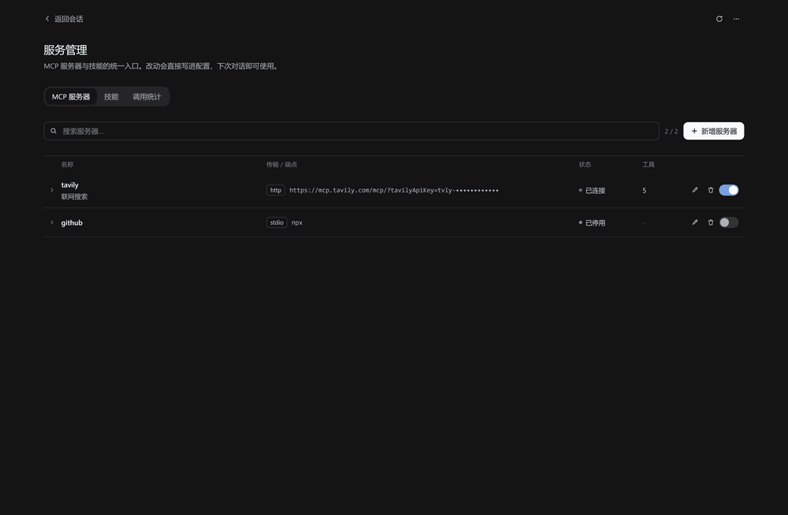
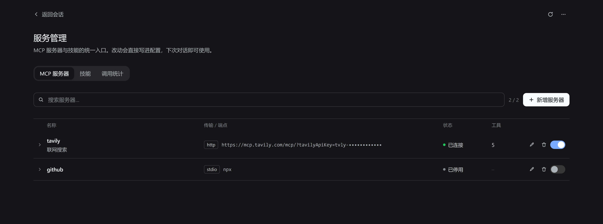
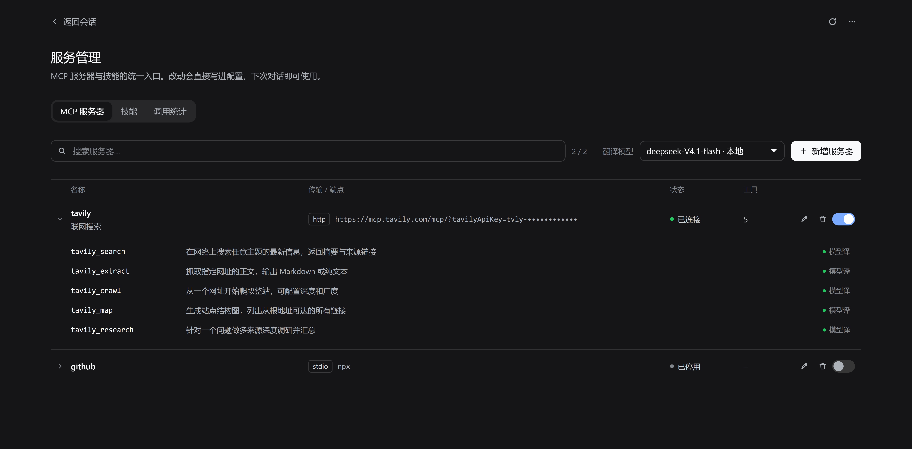
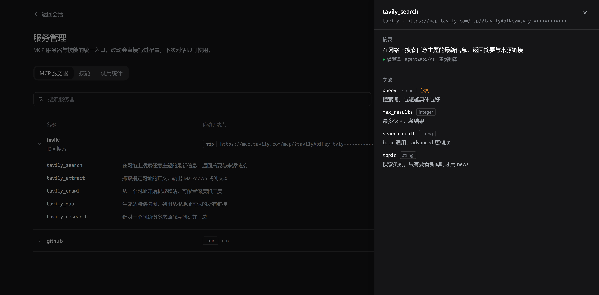
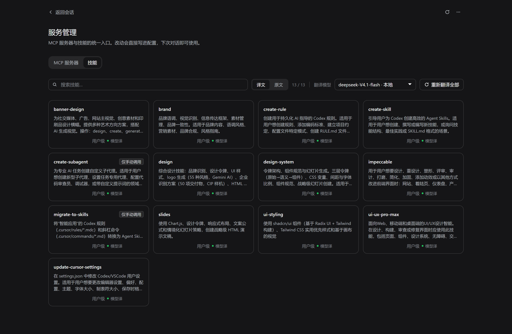

<div align="center">

# DSH 服务管理页

**在 DeepSeek Harness 里，一个页面管完所有 MCP 服务器和 SKILL。**

增删改启停不用碰 YAML · 浏览技能 · 用你自己的模型把英文摘要翻成中文 · 看清楚到底谁被调用了多少次

[](LICENSE)
[](#兼容性)
[](#开发)
[](package.json)

[English](README.md) · 简体中文



</div>

## 为什么做这个

DSH 官方没有 MCP 管理界面——想加一台服务器只能手写 YAML，想确认它连上没有只能回会话里试。技能则是磁盘上的一堆文件，摘要全是英文，看过一次就忘。

这个插件补上缺的那一页。它**从不修改你的 DSH 配置文件**——通过官方的 `cordis:include` 机制加载自己独占的一个文件，`cordis.patch.yml` 保持你写的样子。

## 目录

- [功能](#功能) · [截图](#截图) · [环境要求](#环境要求) · [安装](#安装)
- [使用](#使用) · [它会写哪些文件](#它会写哪些文件) · [安全边界](#安全边界)
- [工作原理](#工作原理) · [兼容性](#兼容性) · [常见问题](#常见问题)
- [开发](#开发) · [参与贡献](#参与贡献) · [License](#license)

## 功能

### MCP 服务器

- **不碰 YAML 的增删改查** —— 在表格里新增、编辑、删除、启停
- **展开看工具** —— 每台服务器注册了哪些工具，一行一个，鼠标悬停看完整英文原文
- **工具抽屉** —— 上面是摘要，下面是参数表；参数说明翻译过，参数名保持英文，因为那是你真正要敲的标识符
- **重连看得见** —— 保存后触发后台 include 刷新，页面轮询重连状态，而不是让你对着转圈干等
- **支持 `${环境变量}`** —— 密钥留在环境里，不写进配置文件

### 技能

- **列出 DSH 能看到的全部技能**，摘要和正文分成两层展示
- **用你自己的模型翻摘要** —— 下拉框列出 DSH 里配置的所有 provider × model，默认取你的默认模型，选择会记住
- **`译文 / 原文` 一键切换全部**，卡片右下角 **↻** 单独重翻，工具栏还能批量重翻
- **落盘缓存** —— 第二次打开是零请求
- **失败可见** —— 模型翻不动时卡片明确标出 `机翻`，不会假装成功
- **删除技能** —— 直接在这一页删掉

> 翻译只影响你看到的字。`SKILL.md` 一个字节都不改，注入给模型的仍然是英文原文。

### 调用统计

每台 MCP 服务器、每个技能被调用了多少次，从安装当天起累计。不用翻会话日志就能回答「这台服务器值不值得占我那么多上下文」。

MCP 的失败次数也在这里，并按六类归因：网络/超时、鉴权失败、参数错误、服务端错误、调用被取消、未知。点选一台服务器，图表从「按服务器」切换为「按错误类型」，每类带一句原因说明，并保留原始错误码与脱敏后的样本。

表格上方是近 14 天的调用柱状图；每一行右侧还有自己的迷你柱，条尾的红色段显示失败占比。

### Agent 工具

插件同时注册了一个 `mcp_service` 工具，所以在会话里直接说「帮我把 filesystem 这个 MCP 装上」就行，不用切页面。

| 动作 | 说明 | 需要审批 |
|---|---|---|
| `list` | 列出服务器、传输方式、状态、工具数 | 否 |
| `install` | 新增或更新一台服务器 | **是** |
| `remove` | 删除一台服务器 | **是** |
| `enable` / `disable` | 启停一台服务器 | 否 |

审批走 DSH 官方的一次性授权接口：拒绝、取消、或无可用应答方时**一律不改配置**，失败闭合。参数不合法会在弹窗之前就报错，不拿无效请求打扰你。

### 明暗主题

全部走 DSH 的设计 token，明暗自动跟随，不需要额外设置。

## 截图

<table>
<tr>
<td width="50%">

**MCP 服务器**



行尾常驻三个操作：编辑、删除、启停开关。

</td>
<td width="50%">

**展开看工具**



每个工具一行摘要，超出折成省略号，悬停看英文原文。

</td>
</tr>
<tr>
<td>

**工具详情**



上面是译文摘要，下面是参数表。

</td>
<td>

**技能**



`译文 / 原文` 切换全部，↻ 单独重翻。

</td>
</tr>
</table>

**调用统计**


## 环境要求

- DeepSeek Harness `>= 0.2.0-rc.1 < 0.3.0`
- `pnpm` 在 `PATH` 上（插件管理器会用到）
- Windows / macOS / Linux 桌面端

## 安装

打开 **设置 → 插件**，把下面任意一个填进安装框：

```
github:Baisbt/Baisbt-dsh-service-manager
```

```
https://github.com/Baisbt/Baisbt-dsh-service-manager
```

装完**刷新页面**（`Ctrl+R`），侧边栏会出现 **服务管理**。

> 也可以用 npm 包名安装，等发布到 npm 之后可用。
>
> ⚠️ 从别的来源重装同一个包之前（比如先装过本地目录），请先清掉 `node_modules` 里的残留，否则会报 `ERR_PNPM_EPERM`。原因和修法见[常见问题](#常见问题)。

## 使用

**MCP 服务器** —— 点一行展开它的工具。展开一台带工具的服务器后，工具栏会出现模型下拉框，选好模型工具摘要就会翻译。

**技能** —— 摘要默认英文。选一个模型，点 **重新翻译全部**，卡片会逐块填上译文。工具条上的开关切换全部卡片；卡片右下角的 ↻ 只重翻那一张。

**调用统计** —— 只读计数，一行一台服务器、一个技能。

**打开配置目录** —— 页面上有个入口可以在文件管理器里打开 profile 目录（`explorer.exe` / `open` / `xdg-open`）。它只是打开文件夹，插件不会去改你自己的文件。

## 它会写哪些文件

插件自己的东西全部落在 profile 目录里，别处一概不碰。

| 路径 | 是什么 |
|---|---|
| `<profile>/mcp-servers.yml` | 生成的 MCP 行，`cordis:include` 的加载目标 |
| `<profile>/.dsh-service-manager/servers.json` | 服务器列表的数据源 |
| `<profile>/.dsh-service-manager/translations.json` | 翻译缓存，按原文哈希索引 |
| `<profile>/.dsh-service-manager/stats.json` | 调用计数 |
| `<profile>/.dsh-service-manager/settings.json` | 你选的模型 |
| `<profile>/.dsh-service-manager/diagnostics.json` | Agent 工具与加载期探针的健康状态 |

`<profile>` 是 `~/.dsh/profiles/<名字>`，Windows 上通常是 `%USERPROFILE%\.dsh\profiles\desktop`。

## 安全边界

- 只写上面列出的文件
- **不修改** `cordis.patch.yml`、`cordis.yml`、`.credentials.yaml`
- 密钥建议写成 `${ENV_NAME}`，加载时从环境变量读取，配置文件里不留明文
- Host 半区跑在 **DSH 进程内**，不受工作区沙箱限制——装陌生人的插件前请先看源码

## 工作原理

```
cordis.patch.yml (插件自带)
  └─ service-manager            ← 本插件 Host 半区（路由 + Agent 工具 + 翻译）
  └─ service-manager-mcp
       cordis:include → ./mcp-servers.yml    ← 本插件生成、独占的 MCP 行
```

页面通过 `ctx.connection.fetch.register` 提供的 `/api/service-manager/*` 路由读写数据。写完之后插件刷新 include 子树，让 MCP 桥重新连接；前端轮询这个状态，而不是阻塞等待。

翻译走 `ctx.get("llm").stream(...)`，用你选的模型，结果写回 `translations.json`，重启后仍然有效。

## 兼容性

- DSH `>= 0.2.0-rc.1 < 0.3.0`
- Windows / macOS / Linux 桌面端
- 明暗主题自动跟随
- 无构建步骤、无运行期依赖

## 常见问题

### 安装报 `ERR_PNPM_EPERM: operation not permitted, rename ...`

换安装来源时最容易遇到。DSH 的卸载只改 `package.json`，**不会删除 `node_modules` 里已装好的目录**；pnpm 安装时要把临时目录 rename 成正式目录名，而这个位置上已经存在一个目录，Windows 不允许 rename 覆盖非空目录。

```
[ERR_PNPM_EPERM] [importPackage ...\node_modules\dsh-service-manager]
EPERM: operation not permitted, rename '...dsh-service-manager_tmp_1234_2' -> '...\dsh-service-manager'
```

这跟插件是否在运行无关，重启没用。先删掉残留再装：

```cmd
:: 本地 link: 安装留下的 Junction —— 只删链接，源码不受影响
cmd /c rmdir "<profile>\node_modules\dsh-service-manager"

:: 真实目录 —— 执行前务必确认路径，这条会真的删文件
cmd /c rmdir /s /q "<profile>\node_modules\dsh-service-manager"
```

不确定是哪种？`dir "<profile>\node_modules" | findstr dsh-service-manager`，带 `<JUNCTION>` 标记的是链接。

### 装完侧边栏没出现

刷新页面（`Ctrl+R`）。Host 半区装完立即生效，前端 bundle 需要重新加载一次。

### GitHub 安装卡很久

日志里出现 `HEAD https://github.com/... ETIMEDOUT` 是网络抖动，pnpm 会自动重试。首次安装实测一到两分钟。

### 翻译一直停在「翻译中」

单条请求超时 45 秒，整批总预算 75 秒。先确认 **设置 → 模型** 里的默认模型可用，再点卡片右下角的 ↻ 重试；在上方下拉框换一个模型也可以。

### 卸载后我的数据还在吗

在。卸载只会移除依赖项、bundle 项和 `node_modules` 里那份副本，`mcp-servers.yml` 和 `.dsh-service-manager/` 都留在原地。但 MCP 服务器本身会跟着插件消失——它们由插件的 `cordis:include` 行加载；重新装回来即可，配置和数据都还在。

## 开发

没有构建步骤，`index.js` 和 `client.js` 都是直接运行的 ESM。

```bash
# 离线渲染冒烟：用最小 React 替身把三个页面、两个抽屉、中英两种语言都渲染一遍
node test/render-smoke.mjs
```

README 里的截图不是手截的，是用真实组件、真实 CSS、真实设计 token 在无头浏览器里渲染的，`/api/*` 打了桩，示例数据在 `docs/preview/fixtures.json`：

```bash
node docs/preview/serve.mjs   # 然后打开 docs/preview/index.html
```

这个预览环境也是改 UI 最快的路子——不用安装任何东西。

## 参与贡献

Issue 和 PR 都欢迎。两个让改动更容易被接受的点：

- Host 半区不要引入新的运行期依赖，它故意是纯 ESM
- 提 PR 前跑一遍 `node test/render-smoke.mjs`，它不开浏览器就能抓到渲染断裂

## License

[MIT](LICENSE) © 2026 Baisbt
